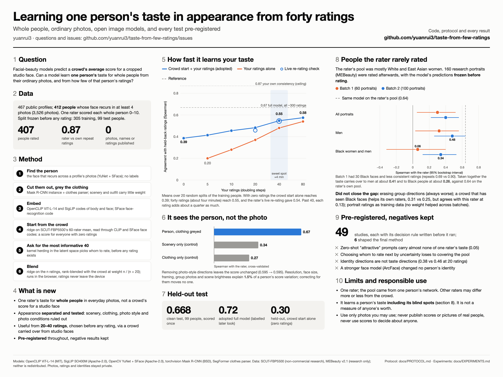

# Taste from few ratings

**Learn one person's taste in other people's appearance from about 40 ratings, using open image models.**

Standard facial-beauty prediction learns a *crowd's average* score for a cropped studio face.
This project learns *one rater's* 0–10 judgement of whole people from ordinary photos, starts
from a crowd model so that a few ratings already work, and tests every step with a decision rule
written before the test ran. Photos, ratings and the people in them never leave the rater's
machines; this repository holds only code, the protocol and aggregate results.



[Poster (PDF)](poster/poster.pdf) · [Protocol: every rule and result](docs/PROTOCOL.md) · [All experiments](docs/EXPERIMENTS.md)

## Results (one rater, 407 rated people)

| Ratings from the rater | Agreement with their held-back ratings (Spearman) |
| --- | --- |
| 0 (crowd face model only) | 0.39 |
| 10 | 0.46 |
| 20 | 0.48 (live check: 0.46) |
| 40 | 0.55 (live check: 0.54) |
| ~300, full model, cross-validated | 0.68 (held-out accounts, previous version: 0.72) |
| Held-out test set, 99 people, scored once | 0.668 |
| The rater against their own repeat ratings | 0.87 |

The 0–40 rows are means over 20 random splits; the live checks are the rater re-rating the
chosen people in the browser. Forty ratings (about four minutes) is the sweet spot: each rating
up to 40 adds about the same, after that each adds a quarter as much.

**Does the latent space miss something?** The rater agrees with their own repeats at 0.87, so about half of
what is predictable is still missed. Five probes found no visual cause: best-photo aggregation, style, several
"types", and face and body measurements on the errors all came out no better. People the rater follows are
predicted worse (0.43 vs 0.58), a hint that outside knowledge enters the ratings (not significant).

**Which photo of a person?** Trained only on ratings of whole people, the model can still tell a person's
photos apart. In a frozen-prediction test the rater picked the model's best over its worst photo of the same
person in 21 of 27 pairs (78%); across all pairs, including near-ties, 62% (not significant by the rule).

**Groups the rater rarely rated.** On 160 research portraits rated afterwards (predictions frozen
before rating), the face model ranked men at about 0.41 and Black people at about 0.26, against
0.64 on the rater's own photo pool. Public crowd models did not close that gap, and nor did
portrait ratings added as training data (details in the poster and [the protocol](docs/PROTOCOL.md)).

## What is new

1. **One person's taste, for whole people, from ordinary photos**, not a crowd's score for a
   studio face. The crowd is only the starting point.
2. **Appearance separated from everything else, and tested.** Each photo is reduced to its
   owner (found without labels as the face that recurs across the photos), cut out on grey with
   clothing greyed. Control models show the taste is not scenery (0.34 vs 0.67), clothing (0.27)
   or photo style; photo conditions move a person's score by 1.5% of its variation.
3. **Useful from about 20–40 ratings, chosen before any rating exists.** Kernel herding in the
   image models' latent space picks whom to rate first; a crowd model on face-recognition codes
   (which ignore lighting and make-up) carries over from studio faces to everyday photos.
4. **Private by design.** The onboarding page fits the model inside the browser from a
   similarity matrix; ratings never leave the device. No social-media metadata is used.
5. **Pre-registered, with the negative results kept**: around fifty tests, most of which did not
   pass their rule, are listed with their numbers.

## How it works

```
photos/<person>/*.jpg
   │  owner_cutouts.py   face that recurs across a person's photos → that person, cut out on grey,
   │                     clothing greyed (Mask R-CNN, SegFormer clothes parser, YuNet + SFace)
   ▼
cut/<person>/*_{nocloth,face}.jpg
   │  features.py, embed_more.py   OpenCLIP ViT-L-14 and SigLIP codes of each cut-out and face
   ▼
features.npz ──► taste_onboard.py   crowd score (SCUT-FBP5500 ridge on CLIP + SFace face codes)
             │                      + kernel-herding picks + ridge on n ratings, blended n/(n+20)
             └─► taste_full.py      once many ratings exist: photo-level ridge on all codes
```

## Use it

You need a GPU (one per job; written as Slurm jobs, any GPU machine works) and Python 3.9+.

```bash
git clone https://github.com/yuanrui3/taste-from-few-ratings code
python3 -m venv venv && venv/bin/pip install -r code/requirements.txt
```

Work from the folder that holds `code/` (the scripts expect `code/taste`, `code/idscore`, and
data folders next to `code/`):

| Step | Command | Output |
| --- | --- | --- |
| 1. Photos | your own folders: `photos/<person>/*.jpg`, at least 4 photos per person | |
| 2. Cut out each person | `sbatch code/taste/gpu_job.sh code/taste/owner_cutouts.py --photos photos --out cut --models models` | `cut/` |
| 3. Embed | `… features.py --cut cut --out features.npz --models models`, then `… embed_more.py --root .` | `features*.npz` |
| 4. Split and rating order | `venv/bin/python code/taste/freeze_split.py cut/owners.json - split` | `split/` |
| 5. Rate | `pack_rating.py cut split site`, then `rate_server.py site` and open the page | `site/ratings.jsonl` |
| 6. Ratings file | `ratings_effective.py site/ratings.jsonl split` | `split/ratings_effective.json` |
| 7. Crowd model | download SCUT-FBP5500 from its authors to `datasets/scut/scut.zip`, then `scut_prep.py .` and `experiments/sface_crowd.py` | `datasets/scut/*.npz` |
| 8a. New rater, 40 ratings | `taste_onboard.py probes --n 40`, then `export site/onboard_data.json` and serve `onboard.html` | ranking in the browser |
| 8b. Many ratings | `train_eval.py --stage cv` (decide), `--stage test` (once), `taste_full.py` | `results/` |

Run every `--prefetch` step (model downloads) where there is internet before submitting GPU
jobs; compute nodes often have none. `gpu_job.sh` takes your allocation and partition from
`sbatch -A … -p …`.

## Use it responsibly

- **Only photos you may use, of people who would not object.** The first study used public
  profiles and kept everything private; that is the minimum. Better: people who agreed.
- **Never publish rankings, scores or pictures of real people**, and never use the scores to
  make decisions about anyone (hiring, admission, moderation, matching without consent).
- **It learns one person's taste, including its biases.** A rater who rarely saw a group will be
  modelled poorly for that group (measured above). It is not a measure of anyone's worth.
- Keep data folders outside the repository (`.gitignore` excludes the usual ones).

## Models and data

Open models: OpenCLIP ViT-L-14 / ViT-H-14 (MIT), SigLIP SO400M-384 (Apache-2.0), DINOv2-L
(Apache-2.0), OpenCV YuNet and SFace (Apache-2.0), torchvision Mask R-CNN and Keypoint R-CNN
(BSD), SegFormer clothes parser (`mattmdjaga/segformer_b2_clothes`). Optional: InsightFace
`buffalo_l` (ArcFace, non-commercial research only).
Datasets are not included; get them from their authors: SCUT-FBP5500 (non-commercial research),
MEBeauty (research only; used for the group tests).

## Repository layout

```
taste/                pipeline scripts, rating and onboarding pages (rate.html, onboard.html)
taste/experiments/    one-off studies; each has a section in docs/PROTOCOL.md
idscore/              face detection / recognition and clothes-parsing helpers used by the pipeline
docs/PROTOCOL.md      lab notebook: rules written before each test, then the result
docs/EXPERIMENTS.md   every experiment, its question and its outcome
poster/               the poster (PDF, PNG and HTML source)
```

## Cite and license

See [`CITATION.cff`](CITATION.cff). Code under the [MIT License](LICENSE); the datasets and models keep their own licenses.
